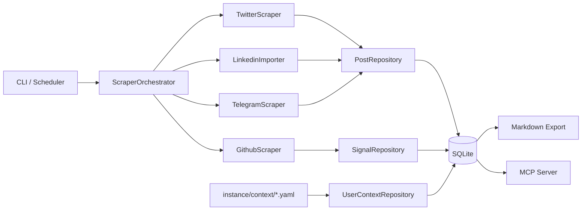
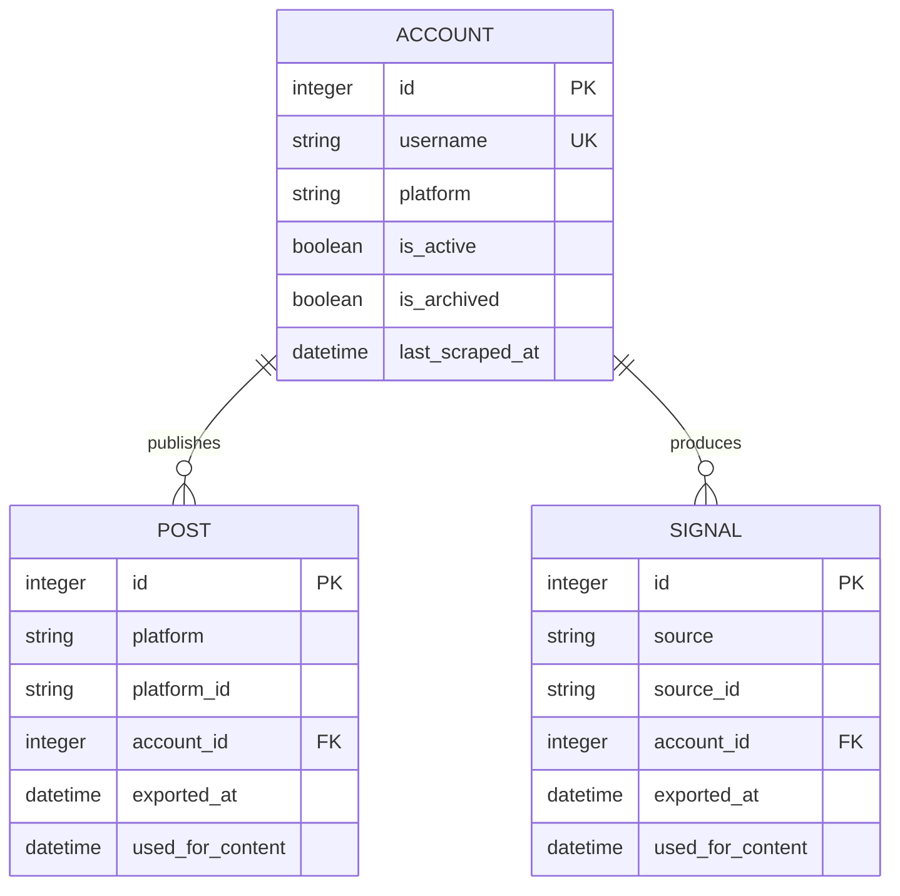

# Architecture

This document is the technical source of truth for EANyra. For setup and daily
usage, start with the repository [README](../README.md). For known defects and
planned changes, see [ROADMAP.md](ROADMAP.md).

## System Purpose

EANyra is a local data pipeline for AI-assisted content creation. It keeps three
types of information together:

1. **Posts**: content already published on a social platform.
2. **Signals**: events or notes that may become future content.
3. **Context**: author voice, platform rules, biography, and active projects.

SQLite is the integration boundary. Collection modules write normalized data;
the export and MCP layers read it without contacting live platforms.

## Runtime Components



### Entry Points

| Entry point | Responsibility |
|---|---|
| `src/core/cli/index.js` | CLI bootstrap, model registration, schema sync, command routing |
| `src/core/cli/login.js` | Interactive Twitter/X login and persistent session creation |
| `src/core/cli/telegram-login.js` | Interactive Telegram MTProto login and session string generation |
| `src/core/mcp/server.js` | MCP tool registration and stdio/HTTP transport startup |
| `src/core/cli/import-cookies.js` | Standalone cookie import helper used by `npm run import-cookies -- <file> --session <name>` |
| `src/core/cli/vaultCommands.js` | `vault`, `secrets` and `sessions` commands |
| `src/web/start.js` | `eanyra serve`: local web UI, JSON API, optional scheduler |

The scheduled daemon is the CLI process running `Scheduler`. The optional web
server (`eanyra serve`) is a single local process that serves the browser UI
and a JSON API, and can run the scheduler too.

## Web Server

```text
browser ──► src/web/server.js ──► toolRegistry (same tools as MCP) ──► services / SQLite
                    │                         └─► ScrapeJobs / TelegramPublishRequests ──► worker processes
                    └─► routes: sessions report, context sync, Telegram drafts
```

- `src/web/server.js`: `node:http`, no framework. Loopback bind, Host check
  (DNS rebinding), `X-EANyra` header + Origin/Sec-Fetch-Site check on POST
  (CSRF), 64 KiB JSON bodies, strict CSP, static files from `src/web/public/`.
- `src/web/auth.js`: master-password login (unlocks the vault via
  `unlockSharedVault`) or a startup token without a vault; in-memory sessions
  with idle expiry; login throttling.
- `POST /api/tools/<name>` runs any registered tool through `callTool`, which
  validates arguments with the tool's JSON schema exactly like MCP.
- `--mcp` mounts `core/mcp/mcpServer.js` (`createMcpServer`,
  `McpHttpSessions`, shared with the standalone MCP server) at `/mcp`. It
  requires `Authorization: Bearer` with the vault secret `mcp-token/default`
  (legacy: `MCP_HTTP_TOKEN`), compared by SHA-256 digest in constant time,
  refuses any `Origin`, and answers 503 while no token is readable (locked
  vault).
- `src/web/public/`: dependency-free UI; untrusted collected text is only set
  through `textContent`.

## Repository Layout

```text
EANyra/
  package.json
  README.md
  .env                          local credentials and runtime settings, gitignored
  docs/
    ARCHITECTURE.md
    CONTEXT_GUIDE.md
    PROJECT_CONTEXT_PROMPT.md
    PRODUCT_VISION.md
    ROADMAP.md
    old/                         archived source documents, not authoritative
  skills/eanyra/SKILL.md
  instance_example/           versioned defaults; no personal data
    .env.example
    accounts.json.example
    context/
      *.example.yaml
      projects/_template.yaml
  instance/                     instance-specific, entirely gitignored
    accounts.json
    context/                    editable voice, bio, rules and projects
    data/
      pot.sqlite
      nyra/                     persistent Playwright profile
      imports/                  LinkedIn CSV files
      exports/                  generated Markdown exports
  src/
    config/
      app.config.js             environment parsing and defaults
      instance.js               instance selection and environment loading
    core/
      browser/                  Playwright browser, per-session contexts, stealth patches
      secrets/                  encrypted vault, unlock paths, per-session credentials
      cli/                      Commander commands
      export/                   Markdown formatter
      mcp/                      MCP server, SQLite queries, tools
      orchestrator/             collection coordination
      scheduler/                cron wrapper
      teapot/                   Sequelize models and repositories
    platforms/
      twitter/
      github/
      linkedin/
      telegram/
    shared/                     logging and generic utilities
```

`teapot` is the project name for the database layer; it is not a separate
service.

## CLI Bootstrap

Every normal CLI command follows this startup sequence:

1. Load the root `.env` and select INSTANCE_DIR through `config/instance.js`.
2. Resolve configuration in `src/config/app.config.js`.
3. Connect Sequelize to the configured SQLite file.
4. Register all Sequelize models and associations.
5. Apply pending schema migrations.
6. Parse and execute the Commander command.

Schema creation and changes use the versioned runner in
`core/teapot/SchemaMigrator.js`. Startup applies pending migrations only. It
does not run `sequelize.sync()`, `sequelize.sync({ alter: true })`, or disable
SQLite foreign-key checks.

Applied migration names are recorded in the `schema_migrations` table.
Changing a Sequelize model does not change the database automatically; every
schema change must include a new migration.

## Collection Flow

`ScraperOrchestrator.run({ platform? })` coordinates one collection run:

1. Create a `scraper_runs` row with status `running`.
2. Read `instance/accounts.json` and upsert configured accounts.
3. Load active accounts and optionally filter by platform.
4. Lazily launch one Chromium if Twitter accounts exist and open an isolated
   context per X session, loading its storage state from the vault.
5. Lazily connect one Telegram MTProto client per Telegram session.
6. Dispatch each account to its platform module.
7. Persist normalized posts or signals through repositories.
8. Update each successful account's `last_scraped_at`.
9. Save refreshed X storage states back into the vault, close runtime clients
   and finalize the run as `success`, `partial`, or `failed`.

## Sessions and Credentials

Each account names its login with `session` (default `default`); Telegram
channels name their publishing bot with `bot`. `core/secrets/Credentials.js`
resolves these names to secrets in the encrypted vault
(`core/secrets/Vault.js`, AES-256-GCM, scrypt key derivation). Without a vault
file the legacy plaintext `.env` provides the `default` session only.

The orchestrator groups X profiles by session; the long human-like pause
applies only within one session and a rejected login (`SESSION_ERRORS`) skips
only its own accounts. Workers spawned by MCP receive the vault key over IPC.
Background processes unlock through the Windows DPAPI-protected remembered key
or `EANYRA_MASTER_PASSWORD`; interactive commands prompt. See
[ACCOUNTS_AND_SECRETS.md](ACCOUNTS_AND_SECRETS.md).

The `posts_saved` field in `scraper_runs` is currently used for the total number
of newly persisted records, including GitHub signals.

### Scheduling

`Scheduler` wraps `node-cron`.

- Cron expression: `CRON_SCHEDULE`, default `0 8 * * *`
- Timezone: always UTC
- Optional immediate run: `RUN_ON_STARTUP=true`
- Default CLI behavior with no command: start daemon mode

The scheduler catches run errors so a failed scrape does not stop future cron
ticks, and `noOverlap` skips a tick while a collection is still running.

### Stopping

`ScraperOrchestrator.run(selection, { signal })` checks the signal between
accounts and cuts pauses short; its `finally` still closes runtime clients
(saving X storage state) and releases the scrape lock, and the run is
recorded as `partial` ("Stopped on request"). `shared/shutdown.js` installs
two-stage SIGINT/SIGTERM handling (graceful, then forced) used by the CLI,
daemon, web server and MCP server. Scrape workers stop on an IPC
`{ type: 'stop' }` (or their own SIGINT); `ScrapeJobs.shutdown()` waits for
them before killing, and `TelegramPublishRequests.drain()` lets in-flight
publications finish.

## Platform Modules

Platforms: Twitter/X, LinkedIn and Telegram (posts), GitHub and Discord
(signals). Platforms are registered in two places that must agree (enforced at import
time and by tests):

- `platforms/catalog.js`: dependency-free metadata — id, display name, where
  records go (`output`: posts or signals), which secret kind holds its login
  (`session`), and publishing mode. `SUPPORTED_PLATFORMS`, session validation
  and MCP enums derive from it.
- `platforms/collectors.js`: one adapter per platform:

```js
collect({ account, entry, session, runtime, repos }) → { records, scrapedAt? }
```

A collector only fetches and normalizes. The orchestrator is platform-agnostic:
it owns sessions and runtime clients (`runtime.twitterSession(name)`,
`runtime.telegramScraper(name)`, `runtime.credentials`), pacing, persistence by
`output`, account health and per-account run records.

## Problem Alerts

`core/notify/`: `problems.js` derives problems with stable keys from the
session report, `accounts.last_error`, stale accounts, the latest run and the
Telegram outbox; `Notifier.js` sends one digest of new, repeated (after
`repeat_hours`) and resolved problems and keeps state in `source_state`
(source `notify`); `channels.js` delivers through the Telegram Bot API or a
Discord webhook (no mentions, secrets never in errors). If every channel
fails, the state is kept so the next check retries. `ScraperOrchestrator`
calls `runProblemChecks` after every run; alert errors never change the run's
result. Configuration: `instance/notifications.json` (`config/notifyConfig.js`).

## Shared Services

`core/services/` holds logic shared by all front ends. Services take a small
SQL executor (`all`, `get`, `run`) so the same code runs on Sequelize (CLI,
workers) and on the direct sqlite3 connection (MCP, the planned web server):

| Service | Responsibility |
|---|---|
| `JobStore` | Durable background jobs (`jobs` table), orphan recovery by worker PID |
| `StatusService` | Health, freshness per platform and account, per-run account outcomes |
| `ContentService` | Drafts, manual signals, signal→publication attribution, content plan, performance |
| `draftLinks` | Map a published URL to the collector's `platform_id`; link drafts to collected posts |

### Twitter/X

Files:

- `platforms/twitter/TwitterScraper.js`
- `platforms/twitter/humanBehavior.js`
- `core/browser/Browser.js`
- `core/cli/login.js`

Twitter uses one Playwright Chromium process with a separate, non-persistent
context per X session; cookies and local storage come from the vault. The
browser wrapper configures viewport, locale, timezone, launch flags, blocked
telemetry domains, and browser API patches.

Collection behavior:

1. Open the profile and explicitly click the Replies tab, then fall back to
   direct `/with_replies` navigation or the Posts timeline.
2. Wait for tweet article elements.
3. Simulate page landing and human-like scrolling.
4. Intercept profile, live-search, and conversation GraphQL responses and
   extract normalized `RawPost` objects with exact metrics and complete text.
5. When the target is not reached, search `from:<username>`.
6. When the target is still not reached, open known authored conversation
   roots to recover thread parts omitted from profile timelines.
7. Extract visible DOM fields as a fallback when network data is absent or
   incomplete.
8. Merge and deduplicate collected results by tweet ID before persistence.
9. Stop early when repeated scrolls load no new post IDs.

The orchestrator chooses scrape depth:

- no prior Twitter post: `INITIAL_POSTS_PER_ACCOUNT`, default `200`;
- existing Twitter data: `POSTS_PER_ACCOUNT`, default `20`.

These values are upper bounds. A run may return fewer records when the profile
timeline contains or exposes fewer entries.

GraphQL extraction is preferred for complete text, exact engagement, media,
language, and reply/repost state. DOM extraction remains a fallback because
Twitter/X may change its internal GraphQL response shape or selectors.
Reply classification is implemented, but exhaustive reply discovery remains an
open issue documented in `TWITTER_SCRAPING_STATUS.md`.

### GitHub

Files:

- `platforms/github/GithubScraper.js`
- `platforms/github/client.js`

GitHub uses the REST API and requires `GITHUB_TOKEN`. It produces normalized
`RawSignal` objects with `source: "github"`.

Signal types:

| Type | Meaning | Stable ID pattern |
|---|---|---|
| `release` | Recent non-draft release | `release:<owner/repo>:<release-id>` |
| `commit_batch` | Commits grouped by ISO week | `commit_batch:<owner/repo>:<week>` |
| `new_repo` | Repository created in the lookback window | `new_repo:<owner/repo>` |
| `readme_change` | README SHA changed | `readme_change:<owner/repo>:<sha>` |

Repository listing is sorted by most recently pushed and capped by
`GITHUB_REPOS_PER_ACCOUNT`. Releases and commits have separate per-repository
limits.

### LinkedIn

Files:

- `platforms/linkedin/LinkedinImporter.js`
- `platforms/linkedin/csvParser.js`

LinkedIn collection is a local import, not a network scraper. The custom CSV
parser supports quoted fields, escaped quotes, multiline fields, and CRLF/LF
line endings.

`Shares.csv` rows are converted to normalized `RawPost` objects. `Profile.csv`
is optional and only logged. LinkedIn exports do not provide engagement
metrics, so those values are stored as zero or null.

### Telegram

Files:

- `platforms/telegram/TelegramClient.js`
- `platforms/telegram/TelegramScraper.js`
- `platforms/telegram/TelegramMessageParser.js`
- `platforms/telegram/TelegramLogin.js`
- `platforms/telegram/sessionEnv.js`

Telegram uses an authenticated GramJS/MTProto client configured by
`TELEGRAM_API_ID`, `TELEGRAM_API_HASH`, and `TELEGRAM_SESSION`. The integration
uses polling only; the listener/event-bus mode from the source modules is not
part of EANyra.

The separate `login:telegram` CLI uses QR login by default through
`signInUserWithQrCode`, with automatic QR refresh and a hidden 2FA prompt.
Phone/code login is available with `--phone`. Login and collection share the
same device settings through `createMTProtoClient`; login starts with an empty
session. After authorization is confirmed, the session is saved atomically to
the root `.env`, preserving unrelated values. Login never prints the session.
Cancellation and failures disconnect and destroy the client.

Collection behavior:

1. The first run for a new Telegram account imports the latest
   `TELEGRAM_INITIAL_POSTS_PER_ACCOUNT` posts, default `20`.
2. The orchestrator stores the newest imported Telegram post timestamp as the
   future polling baseline.
3. Later runs fetch recent channel history pages.
4. Pagination stops when a message at or before the prior scrape boundary is
   reached, with a configurable overlap window for safety.
   If `TELEGRAM_MAX_PAGES_PER_ACCOUNT` is reached first, the unread older
   interval is stored as a checkpoint (`source_state`, source
   `telegram_backfill`: `{ since, before_id }`) and read on the next runs
   before it is cleared; overlapping gaps merge into one interval. Such runs
   are recorded per account as `partial` with the pending interval.
5. Messages are normalized to `RawPost` objects with stable IDs in the form
   `<channel>:<message_id>`.
6. Engagement maps Telegram reactions to `likes`, forwards to `reposts`,
   replies to `replies`, and views to `views`.
7. Persistence uses `PostRepository.saveBatch()`, so overlap and re-runs are
   idempotent.

## Persistence Layer

The persistence layer consists of:

- a Sequelize singleton in `core/teapot/database.js`;
- model factories in `core/teapot/models/`;
- repositories in `core/teapot/repositories/`.

### Associations



`UserContext`, `Project`, and `ScraperRun` are standalone models.

### Tables

#### `accounts`

Stores monitored accounts. `(platform, username)` is unique, so the same
username can be monitored on different platforms. Config is validated before sync.

Important fields: `username`, `display_name`, `platform`, `is_active`,
`is_archived`, `last_scraped_at`.

#### `posts`

Unified table for published content from all platforms.

Important fields:

- identity: `platform`, `platform_id`, `account_id`;
- content: `text`, `lang`, `posted_at`;
- links/media: `media_urls`, `shared_url`, `raw_url`;
- engagement: `likes`, `reposts`, `replies`, `views`;
- flags: `is_repost`, `is_reply`, `visibility`;
- workflow: `exported_at`, `used_for_content`, `scraped_at`.

Deduplication constraint: unique `(platform, platform_id)`.

`PostRepository.saveBatch()` refreshes mutable fields on duplicates. Before
saving, `teapot/recordValidation.js` drops malformed records (missing ids,
wrong platform, invalid dates) with a reason and repairs recoverable values,
so one bad record cannot fail an account's whole batch; the run records the
account as `partial` with the reasons.

#### `signals`

Unified table for content opportunities and source events.

Important fields:

- identity: `source`, `source_id`, optional `account_id`;
- classification: `signal_type`;
- content: `title`, `body`, `url`, `occurred_at`, JSON `metadata`;
- workflow: `exported_at`, `used_for_content`, `scraped_at`.

Deduplication constraint: unique `(source, source_id)`.

#### `scraper_runs`

Audit log for collection runs:

`started_at`, `finished_at`, `status`, `accounts_processed`, `posts_saved`
(new posts), `signals_saved` (new signals), `error_message`.

Statuses are `running`, `success`, `partial`, and `failed`. A run left
`running` by a killed process is marked `failed` by the next run, which holds
the scrape lock and therefore knows no other collection is active.

#### `scraper_run_accounts`

Per-account outcome of each run: platform, username, session, `status`
(`success`, `failed`, `skipped` when its login already failed), records found
and saved, error, timestamps.

`accounts` also carries health: `last_scraped_at` (last success; Telegram's
polling watermark), `last_attempt_at`, `last_error`, `last_error_at`. A
successful collection clears the error.

#### `drafts`

Posts prepared by the agent (`created_by: ai`) or the author (`user`):
`persona`, `platform`, `account`, `text`, `status` (`draft`, `approved`,
`published`, `discarded`), JSON `signal_ids`, `notes`, `published_url`,
`published_at`, and `telegram_request_id` linking a Telegram draft to its
`telegram_outbox` request (`draft-<id>-<text hash>`, so preparing the same text
twice is idempotent). A sent outbox request marks its draft published; any
publication marks the draft's signals `used_for_content`.

`drafts.post_id` links a published draft to its collected post. After every
collection run (and when drafts are read) `linkPublishedDrafts` reduces the
published URL to the collector's `platform_id` (X status id, Telegram
`channel:id`, LinkedIn share/ugcPost id) and fills `post_id`.
`content_performance_get` scores posts as likes + 2·reposts + replies and
compares each draft with the median of the same account in the window.

#### `source_state`

Durable checkpoints per source: `(source, key) → value`. GitHub stores the
last seen README sha per repository (`github_readme`, `<user>/<repo>`), so the
first README observed becomes the baseline for change detection.

Manual signals (`signal_add`) use source `note`/`article`, `source_id`
`manual:<uuid>` and `metadata.persona`, which `signals_get` honours.

#### `linkedin_imports`

One row per LinkedIn export file handled for an account: file name, SHA-256,
size, `status` (`imported`, `failed`), rows, new posts, conflicts (rows
already owned by another account) and the newest post date. The LinkedIn
collector skips a file whose hash equals the last successful import, drops
rows owned by another account with a warning, and records the outcome through
the collector's `onSaved` hook. Collectors may also return `keepWatermark`
(nothing was read; `last_scraped_at` stays unchanged).

#### `jobs`

Durable background requests (`type: scrape`) from MCP, CLI, scheduler or web:
`status` (`queued`, `running`, `success`, `partial`, `failed`), JSON `params`
and `result`, worker `pid`. The worker records start and outcome itself; a job
whose worker process no longer exists is recovered as `failed`.

#### `user_context`

JSON key/value records for `voice`, `bio`, `platforms`, and
`project.<slug>`.

#### `projects`

Structured project metadata: `slug`, `name`, `status`, `description`,
JSON-backed `tech_stack`, `links`, `content_angles`, `posting_rules`, and
`synced_at`.

## Context Sync

`UserContextRepository.sync()` reads:

```text
instance/context/voice.yaml
instance/context/bio.yaml
instance/context/platforms.yaml
instance/context/projects/*.yaml
```

Top-level files are upserted into `user_context`. Each project is upserted into
`projects` and duplicated as `user_context` key `project.<slug>` for direct
lookup.

Only active projects are returned by the full context API. Project sync
reconciles removals without deleting history. A project with `archive: true`,
or a project YAML file removed since the previous sync, is marked `archived` in
SQLite. Sync is currently explicit through `eanyra context sync`; daemon
startup and scrape commands do not invoke it.

`config/contextSchema.js` validates voice, bio, platforms, projects and persona
overrides; a file with errors is skipped and its previous version kept, and
warnings are returned with the sync result. Project discovery ignores templates beginning with
`_` and committed `.example.yaml` files. See the
[Author Context Guide](CONTEXT_GUIDE.md) for the user-facing contract and the
roadmap for known defects.

## Markdown Export

The `export` CLI command uses:

- `ExportRepository` to query context, posts, and signals;
- `MarkdownExporter` to render one AI-oriented Markdown document.

Default behavior:

- include context, active projects, posts, and signals;
- include all never-exported records plus recent records in a 7-day window;
- exclude reposts;
- cap posts and signals at 100 each;
- write to `instance/data/exports/export-<timestamp>.md`;
- mark newly included posts and signals with `exported_at`.

`--platform <name>` selects one publishing platform. `--platforms <list>`
selects several comma-separated platforms, for example
`--platforms twitter,telegram`. Both options filter posts and the corresponding
bio/platform-rule context. Voice, active projects, and signals remain shared
across platform-filtered exports.

`used_for_content` is separate and is set only after confirmed publication
based on a signal or other source record.

Historical `used_for_content` values are not rewritten automatically because
the system cannot distinguish old export timestamps from confirmed-use
timestamps safely.

Use `--no-mark` for a read-only export.

## MCP Layer

The MCP query layer uses direct `sqlite3` queries instead of Sequelize.
Collection runs in a separate worker that initializes Sequelize, migrates the
schema, and invokes the same orchestrator used by the CLI. A file lock for each
database prevents overlapping CLI, cron, and MCP collection.

Intended tools:

| Tool | Purpose |
|---|---|
| `context_get` | Get all author context, one context key, or the merged context of a persona/account |
| `export_get` | Read the latest generated Markdown export |
| `posts_get` | Query normalized published posts |
| `posts_search` | Search normalized post text |
| `posts_stats` | Aggregate engagement by account/platform |
| `accounts_list` | List monitored accounts and record counts |
| `signals_get` | Query content signals |
| `signals_mark_used` | Mark signals as used |
| `scraper_status` | Read collection run health/history |
| `scraper_run` | Start a background collection for all sources, a platform, or one account |
| `scraper_job_get` | Read the background job outcome (durable across restarts) |
| `scraper_jobs_list` | List recent collection jobs from any requester |
| `telegram_messages_get` | Read stored Telegram messages, including forwards/replies, with an insertion cursor |
| `telegram_publisher_info` | Identify the configured publishing bot without sending |
| `telegram_publish_targets` | List explicitly enabled publication channels |
| `telegram_post_prepare` | Persist an exact immutable publication draft |
| `telegram_post_publish` | Claim a draft and publish once with bot or explicit MTProto transport |
| `telegram_post_get` | Read durable publication state and receipt |

Supported transports:

- `stdio`, default, for local MCP clients;
- `http`, Streamable HTTP on `/mcp`, with `/health`, restricted to loopback.

Each HTTP session has its own MCP server, sharing one collection job manager.
Telegram publishing runs in isolated request workers, keeping all runtime logging
off MCP stdout. `telegram_outbox` stores the request ID, exact draft and content
hash, claim state and receipt. Bot API is the default publishing transport;
historical collection continues to use MTProto. Local allowlists and Telegram
channel admin rights are checked before claiming a draft. Uncertain delivery
never automatically resets to draft or resends.
Browser origins are rejected. Jobs and run history are persisted in SQLite;
the MCP server applies pending migrations in a child process at startup. `core/mcp/start.js` loads project-relative paths
consistently even if the MCP client starts in another working directory.

MCP paths, transport settings, routes, and query defaults come from
`src/config/app.config.js`.

## Configuration Boundaries

`src/config/app.config.js` is the runtime configuration source of truth. It
parses environment values, applies defaults, and resolves project-relative
paths.

Major configuration objects:

- `PATHS`
- `MCP`
- `SCHEDULER`
- `DB`
- `BROWSER`
- `TWITTER`
- `SCRAPER`
- `EXPORT`
- `GITHUB`
- `LINKEDIN`
- `TELEGRAM`
- `SUPPORTED_PLATFORMS`

The actual account list is separate in `instance/accounts.json`.

## Extension Guide

### Add a Publishing Platform

1. Add `src/platforms/<platform>/` implementation files returning normalized
   `RawPost` objects.
2. Add a catalog entry in `platforms/catalog.js` (`output: 'posts'`, its
   `session` secret kind or `null`).
3. Add a collector in `platforms/collectors.js`.
4. Add examples, tests, and documentation. CLI validation and MCP enums follow
   the catalog automatically.

### Add a Signal Source

1. Build an importer or collector that returns normalized `RawSignal` objects;
   register it like a platform with `output: 'signals'`.
2. The orchestrator persists it through `SignalRepository`.
3. Add source-specific metadata conventions.
4. Extend export presentation if the new type benefits from special rendering.

### Add an MCP Tool

1. Add a tool definition under `core/mcp/tools/`.
2. Export it in an array with `name`, `description`, `inputSchema`, and
   `handler`.
3. Register the array in `core/mcp/server.js`.
4. Keep SQL parameterized.
5. Add integration tests against a disposable SQLite fixture.

## Operational Constraints

- Runtime data and real context files are gitignored.
- Twitter/X scraping depends on an authenticated session per X login, stored
  in the encrypted vault.
- GitHub collection depends on API rate limits and token access.
- LinkedIn import depends on the shape of LinkedIn's export files.
- Telegram collection depends on Telegram API credentials and a saved MTProto
  session string per Telegram session.
- Credentials require the vault to be unlocked (prompt, remembered DPAPI key or
  `EANYRA_MASTER_PASSWORD`); reading collected data does not.
- SQLite is local and single-host; there is no distributed locking.
- Automated coverage is still focused on parser, migration, and repository
  boundaries rather than live platform access.
- Several confirmed defects are tracked in [ROADMAP.md](ROADMAP.md).
